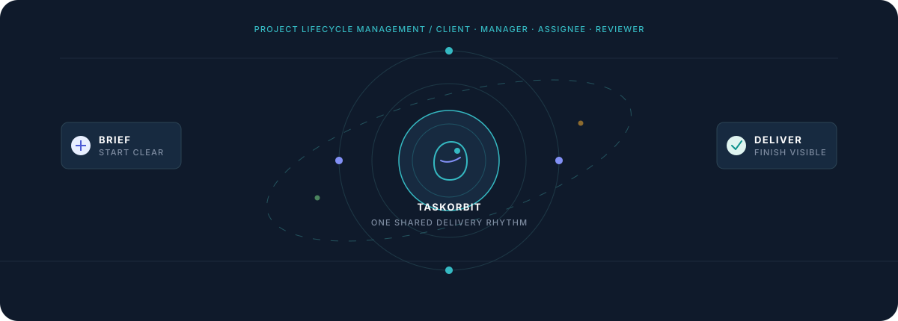
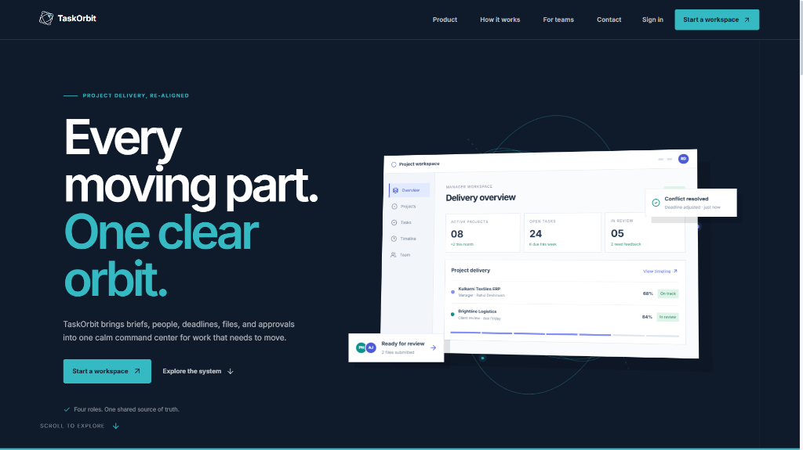
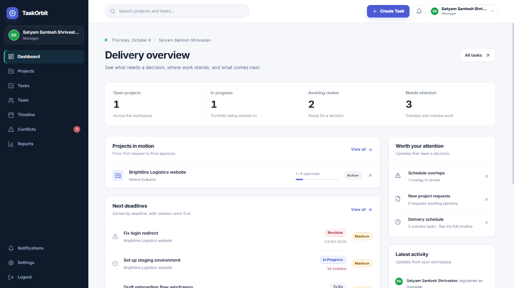
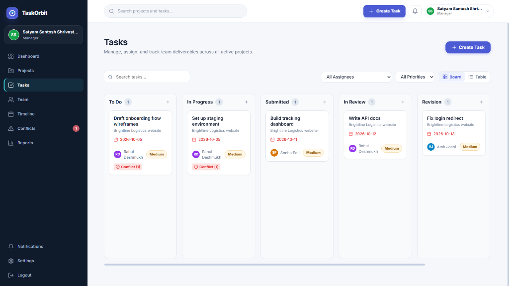
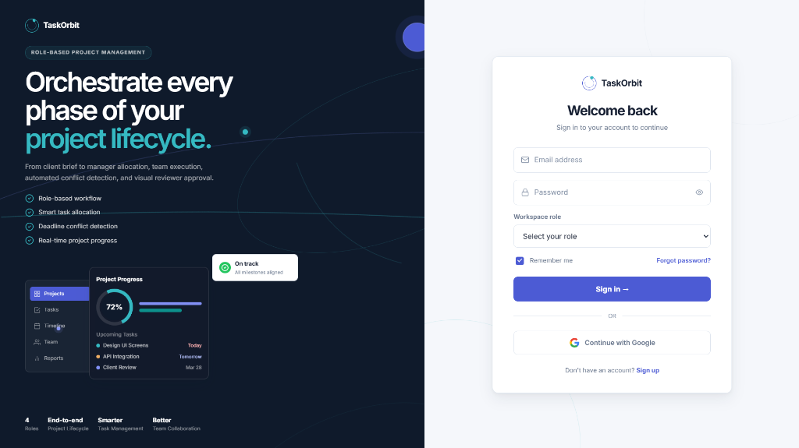
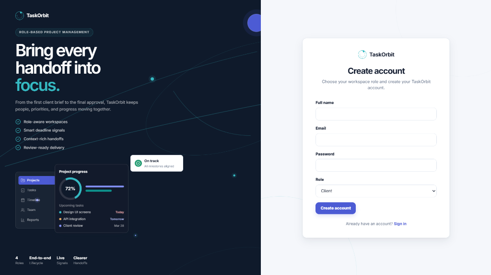
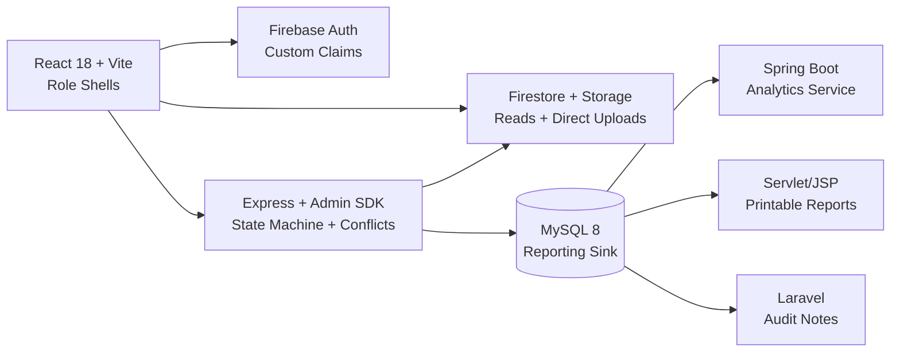

<div align="center">
  

  <h1>TaskOrbit</h1>

  <p><strong>Move every project from brief to delivery with one clear orbit.</strong></p>

  <p>
    An end-to-end, role-aware project delivery workspace designed for clients, managers, assignees, and reviewers.
  </p>

  <p>
    <a href="https://github.com/satyamshrivastav955-dotcom/taskorbit/stargazers"></a>
    
    
    
    
    
    
  </p>

  <p>
    <a href="#overview">Overview</a> ·
    <a href="#key-features">Features</a> ·
    <a href="#product-walkthrough">Screenshots</a> ·
    <a href="#workflow">Workflow</a> ·
    <a href="#architecture">Architecture</a> ·
    <a href="#tech-stack">Tech Stack</a> ·
    <a href="#quick-start">Quick Start</a> ·
    <a href="#testing">Testing</a>
  </p>
</div>

---

## <a id="overview"></a>Overview

**TaskOrbit** is an end-to-end project lifecycle and delivery workspace. Traditional project management software often scatters context across disjointed tools: brief intake happens in emails, execution happens in task boards, feedback is lost in chat threads, and approvals linger in revision limbo.

TaskOrbit unifies the entire delivery chain into a single, cohesive command center:

> **Client Brief → Manager Allocation → Assignee Execution → Reviewer Approval → Completed Delivery**

It connects four distinct role-tailored perspectives with real-time state machines, automated deadline conflict detection, versioned deliverable submissions, and structured revision loops.

<div align="center">
  
  <p><em>TaskOrbit public landing portal and delivery command center</em></p>
</div>

---

## <a id="key-features"></a>Key Features

- 🎯 **Four Dedicated Role Shells**: Tailored, distraction-free workspaces for **Clients**, **Managers**, **Assignees**, and **Reviewers**.
- ⚠️ **Intelligent Conflict Detection**: Automated scheduling conflict engine identifies overlapping deadlines and assignee over-allocation in real time.
- 📋 **Interactive Kanban & Task Pipelines**: Multi-status workflow (`To Do` → `In Progress` → `Submitted` → `In Review` → `Revision`) with priority tags and conflict alerts.
- 🔄 **Structured Submission & Review Cycles**: Built-in file upload mechanisms, versioned asset submissions, and one-click *Approve* or *Request Revision* loops.
- 📊 **Executive Delivery Metrics**: Centralized dashboard summarizing active projects, overdue deliverables, review queues, and team activity.
- 🔐 **Secure Role-Based Access Control**: Powered by Firebase Authentication custom claims, enforced server-side by an Express Admin API.
- 📈 **Pluggable Reporting Sinks**: MySQL sync pipeline with ready-to-run academic analytics slices (Spring Boot, Servlet/JSP, Laravel).

---

## <a id="product-walkthrough"></a>Product Walkthrough

### 1. Delivery Command Center (Manager Overview)

The Manager Dashboard provides complete situational awareness over all active project orbits, upcoming deadline pressures, overdue milestones, and pending stakeholder decisions.

<div align="center">
  
</div>

- **Pulse Metrics**: Immediate visibility into active projects, work in progress, review queues, and tasks needing attention.
- **Projects in Motion**: Real-time completion progress tracking with direct drill-down links.
- **Next Deadlines**: Prioritized delivery agenda highlighting overdue tasks and revision priorities.
- **Attention Alerts**: Surface schedule overlaps and unassigned project briefs before deadlines slip.

---

### 2. Task Lifecycle & Kanban Delivery Board

The Kanban board maps tasks through their natural delivery lifecycle while surfacing live scheduling conflicts directly on task cards.

<div align="center">
  
</div>

- **5-Column Delivery Pipeline**: Seamlessly transition items across `To Do`, `In Progress`, `Submitted`, `In Review`, and `Revision`.
- **Live Conflict Badges**: Visual indicators (`Conflict (1)`) warn managers whenever an assignee is double-booked across concurrent deadlines.
- **Filtered Perspectives**: Instant filtering by Assignee, Priority (`High`, `Medium`, `Low`), and view mode (Board or Table).
- **Submissions & Revisions**: Direct triggers for team members to submit deliverables and reviewers to request revisions.

---

### 3. Role-Aware Authentication & Onboarding

Users enter TaskOrbit through streamlined, role-specific authentication workflows that set up customized permissions and workspaces immediately upon sign-in.

<div align="center">
  <table width="100%">
    <tr>
      <td width="50%" align="center">
        
        <br />
        <strong>Sign In & Role Selection</strong>
      </td>
      <td width="50%" align="center">
        
        <br />
        <strong>Workspace Registration</strong>
      </td>
    </tr>
  </table>
</div>

---

## <a id="workflow"></a>Delivery Workflow

| Stage | What Happens | Primary Owner | Deliverable State |
| :--- | :--- | :--- | :--- |
| **1. Brief** | Client creates project, captures requirements, sets milestones, and uploads initial specs. | **Client** | `Draft` / `Open` |
| **2. Allocate** | Manager decomposes the brief into tasks, assigns team members, schedules dates, and resolves conflicts. | **Manager** | `To Do` |
| **3. Execute** | Assignee accepts task, tracks checklists, uploads work assets, and submits versions. | **Assignee** | `In Progress` → `Submitted` |
| **4. Review** | Reviewer inspects files, compares requirements, and either approves or requests a revision. | **Reviewer** | `In Review` → `Approved` / `Revision` |
| **5. Deliver** | Completion metrics update across the workspace, timeline syncs, and client gains visibility. | **All Roles** | `Delivered` |

---

## Role-Based Workspaces

```
┌─────────────────────────────────────────────────────────────────────────────┐
│                                 TASKORBIT                                   │
└──────────────────────────────────────┬──────────────────────────────────────┘
                                       │
         ┌──────────────────┬──────────┴─────────┬──────────────────┐
         ▼                  ▼                    ▼                  ▼
    ┌─────────┐       ┌───────────┐        ┌───────────┐      ┌───────────┐
    │ CLIENT  │       │  MANAGER  │        │ ASSIGNEE  │      │ REVIEWER  │
    └────┬────┘       └─────┬─────┘        └─────┬─────┘      └─────┬─────┘
         │                  │                    │                  │
         ├─ New Briefs      ├─ Allocate Tasks    ├─ Focused Queue   ├─ Review Queue
         ├─ Requirements    ├─ Fix Conflicts     ├─ Upload Work     ├─ Inspect Files
         ├─ Feedback        ├─ Timeline View     ├─ Checklists      ├─ Approve/Reject
         └─ Track Progress  └─ Team & Reports    └─ Revise Output   └─ Audit History
```

### 👤 Client
- Create project briefs and define requirement scopes.
- Upload reference documents and assets.
- Monitor milestones, stage completion, and approved deliverables in real time.

### 👔 Manager
- Oversee workspace-wide delivery timelines and workload distribution.
- Allocate tasks with intelligent conflict detection to prevent team burnout.
- Manage team members, resolve schedule overlaps, and export executive reports.

### 💻 Assignee
- Focused daily task view eliminating cross-project noise.
- Check off subtasks, attach versioned submissions, and submit work for review.
- Easily review revision feedback and push revised assets.

### 🔍 Reviewer
- Dedicated review queue with instant access to submitted files and criteria.
- One-click *Approve* or *Request Revision* with timestamped feedback threads.
- Comprehensive review log documenting the entire audit trail.

---

## <a id="architecture"></a>Architecture



### Data Flow & Security Model

- **Authentication & Custom Claims**: Firebase Authentication issues JWTs with embedded role claims (`client`, `manager`, `assignee`, `reviewer`), strictly validated by the backend.
- **Primary Data Store**: Cloud Firestore manages real-time workspace records, project briefs, and task boards; Firebase Storage handles deliverables and attachments.
- **State Machine Enforcement**: Node.js + Express API owns complex business logic, strict role state transitions, submission verifications, and conflict calculations.
- **Reporting Sync**: Background synchronization pushes read-only analytical datasets to MySQL for auxiliary reporting services.
- **Credential Hygiene**: All secrets reside in local `.env` files; service-account keys remain strictly outside source control.

---

## <a id="tech-stack"></a>Tech Stack

| Layer | Technologies | Description |
| :--- | :--- | :--- |
| **Frontend Framework** | React 18, Vite, TypeScript | Lightning-fast development & type-safe component hierarchy |
| **State & Navigation** | Redux Toolkit, React Router 6 | Predictable global store and declarative role routing |
| **Styling & Design** | CSS Modules, Design Tokens | Modular styling, dark mode accents, responsive grid layouts |
| **Icons & Visuals** | Lucide Icons, SVG Animations | High-clarity iconography and custom orbit graphics |
| **Auth & Database** | Firebase Auth, Cloud Firestore | Zero-latency document sync and token authentication |
| **File Storage** | Firebase Storage | Secure multi-version asset and deliverable storage |
| **Backend API** | Node.js, Express, Firebase Admin | Role-guarded mutations and conflict detection engine |
| **Testing Suite** | Jest, Supertest, Playwright | Unit, state machine, and browser-driven end-to-end tests |

---

## <a id="quick-start"></a>Quick Start

### Prerequisites

- **Node.js 18+** & **npm**
- A **Firebase project** with Authentication, Firestore, and Storage enabled
- *(Optional)* MySQL 8, Java 17, and PHP 8 if running auxiliary reporting services

### 1. Clone & Configure

```bash
git clone https://github.com/satyamshrivastav955-dotcom/taskorbit.git
cd taskorbit

# Copy environment templates
cp frontend/.env.example frontend/.env
cp node-backend/.env.example node-backend/.env
```

Configure your Firebase client credentials (`VITE_FIREBASE_*`) in `frontend/.env`.  
Add your Firebase Admin private key path in `node-backend/.env` (saved inside the git-ignored `node-backend/credentials/` directory).

### 2. Install & Run Locally

```bash
# Install dependencies
npm --prefix frontend install
npm --prefix node-backend install

# Terminal 1: Start Express API
npm --prefix node-backend run dev

# Terminal 2: Start Vite Dev Server
npm --prefix frontend run dev
```

Visit **<http://localhost:5173/>** in your browser.

### 3. Seed Development Workspace

Populate mock projects, tasks, submissions, and intentional scheduling conflicts to test the conflict engine immediately:

```bash
npm --prefix node-backend run seed
```

> [!NOTE]
> The seed script automatically creates mock credentials across all 4 roles and prints them directly to your console.

---

## <a id="testing"></a>Testing & Quality Assurance

TaskOrbit includes comprehensive automated test suites across unit, API, and end-to-end boundaries:

```bash
# Run backend unit tests and API integration suite
npm test

# Type-check TypeScript and build the production bundle
npm run build

# Run Playwright UI browser test suite
npm run test:ui

# Run Firebase emulator-backed workflow state machine suite
npm run test:workflow
```

---

## Repository Structure

```
taskorbit/
├── docs/                      # Architectural specs, manuals & test checklists
│   ├── assets/                # Screenshots, flow diagrams & SVG loops
│   ├── diagrams/              # Mermaid workflow & architecture docs
│   └── testing/               # E2E manual checklists & Playwright guides
├── frontend/                  # React 18 + Vite + TypeScript web application
│   ├── src/
│   │   ├── components/        # Reusable UI widgets, modals & layout shells
│   │   ├── pages/             # Client, Manager, Assignee, Reviewer pages
│   │   ├── store/             # Redux slices & auth management
│   │   └── services/          # Firebase & Express API client bindings
├── node-backend/              # Express API & Firebase Admin state machine
│   ├── src/
│   │   ├── controllers/       # Route handlers & conflict calculation
│   │   ├── middleware/        # Firebase JWT & role validation
│   │   └── scripts/           # Workspace seeder & MySQL sync utilities
└── scripts/                   # Root dev & test orchestration scripts
```

---

## Documentation Links

- 📘 [System Requirements Specification (SRS)](docs/SRS/outline.md)
- 🚀 [Multi-Service Run Guide](docs/RUN_ALL.md)
- ☁️ [Deployment Guide](docs/DEPLOY.md)
- 📜 [Data Contract & Schema Specification](docs/DATA_CONTRACT.md)
- 🧪 [Testing & QA Guide](docs/testing/README.md)
- 📋 [Manual E2E Testing Checklist](docs/testing/e2e-manual.md)
- 📡 [API Specification & Collections](docs/api/README.md)

---

## License

This project is licensed under the MIT License — see the repository files for details.

<div align="center">
  <sub>Built to bring every handoff into focus.</sub>
</div>
