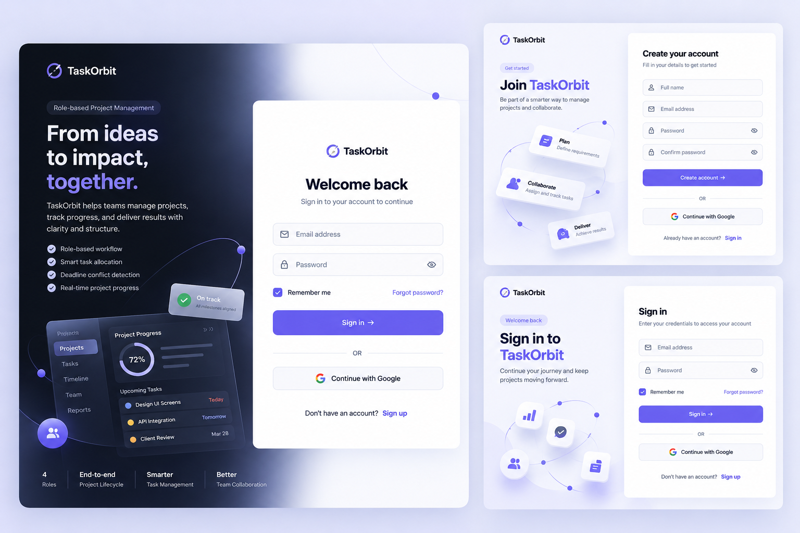
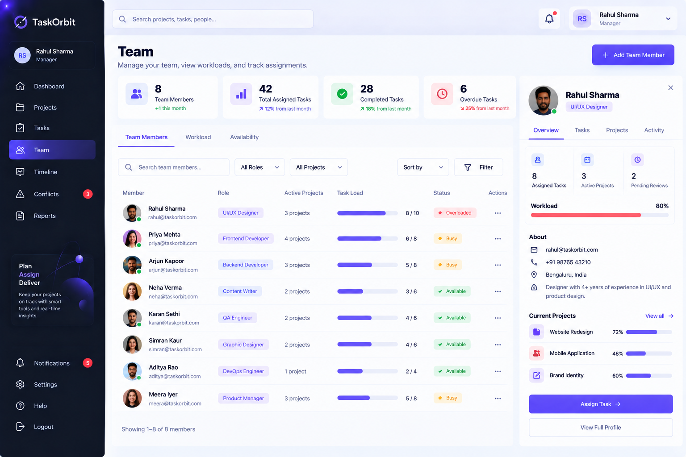
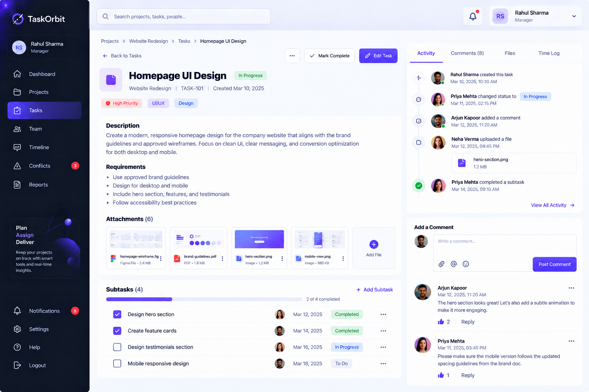
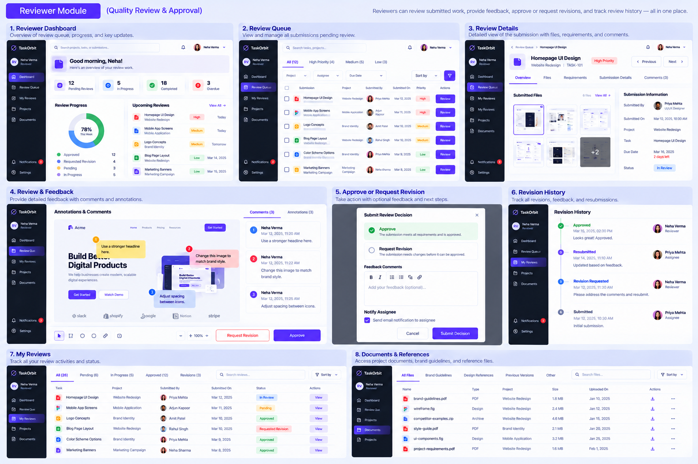
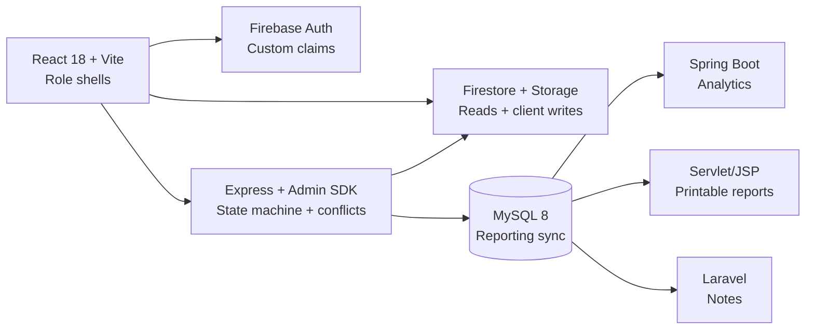

<div align="center">
  

  <h1>TaskOrbit</h1>

  <p><strong>Move every project from brief to delivery with one clear orbit.</strong></p>

  <p>
    Role-based project lifecycle management for clients, managers, assignees, and reviewers.
  </p>

  <p>
    <a href="https://github.com/satyamshrivastav955-dotcom/taskorbit/stargazers"></a>
    
    
    
    
  </p>

  <p>
    <a href="#product">Product</a> ·
    <a href="#workflow">Workflow</a> ·
    <a href="#architecture">Architecture</a> ·
    <a href="#quick-start">Quick start</a> ·
    <a href="#testing">Testing</a>
  </p>
</div>

## Product

TaskOrbit is an end-to-end delivery workspace. It gives each role a focused view of the work while keeping the full project lifecycle connected:

> **Client brief → Manager allocation → Assignee execution → Reviewer decision → Delivered project**

It is designed around the moments that usually get lost between tools: ownership changes, deadline pressure, file submissions, feedback, revisions, and final approval.

<div align="center">
  
</div>

## <a id="workflow"></a>Workflow

| Stage | What happens | Primary owner |
| --- | --- | --- |
| **Brief** | Create a project, capture requirements, and attach source files. | Client |
| **Allocate** | Break the brief into tasks, assign owners, set dates, and detect schedule conflicts. | Manager |
| **Execute** | Start work, complete checklists, attach deliverables, and submit versions. | Assignee |
| **Review** | Open submissions, leave feedback, approve, or request a revision. | Reviewer |
| **Deliver** | Track progress, activity, notifications, reports, and project completion. | Everyone |

## <a id="product"></a>Role-based workspaces

### Client

- Create projects and requirements
- Attach files and share feedback
- Follow project progress and approved work

### Manager

- Coordinate every project and task
- Assign assignees and reviewers
- Resolve deadline conflicts
- Manage the delivery timeline and team
- Export reports and monitor activity

### Assignee

- See only assigned work
- Start tasks and manage checklists
- Upload versioned submissions
- Respond to requested revisions

### Reviewer

- Work from a focused review queue
- Inspect submitted files and requirements
- Approve work or request revision feedback
- Track review history and decisions

<div align="center">
  
  
</div>

## Screens and product surfaces

The repository includes role shells for:

- Public landing page, sign in, and registration
- Manager overview, projects, tasks, timeline, conflicts, team, and reports
- Client overview, projects, requirements, documents, feedback, and progress
- Assignee overview, tasks, revisions, documents, history, and timeline
- Reviewer overview, review queue, history, documents, and review detail
- Shared profile, settings, notifications, and workspace navigation

<div align="center">
  
</div>

## <a id="architecture"></a>Architecture



### Data and security model

- Firebase Authentication handles sign-in and role claims.
- Firestore and Storage hold workspace records and uploaded files.
- Express owns state transitions, conflict detection, submissions, reviews, exports, and protected mutations.
- MySQL is the reporting sink for the academic analytics slices.
- Spring Boot, JSP, and Laravel consume reporting data without writing back to the primary workspace.
- Secrets stay in `.env` files and service-account credentials remain outside version control.

More detail: [`docs/diagrams/architecture.md`](docs/diagrams/architecture.md) · [`docs/diagrams/workflow.md`](docs/diagrams/workflow.md) · [`docs/DATA_CONTRACT.md`](docs/DATA_CONTRACT.md)

## Tech stack

| Layer | Technologies |
| --- | --- |
| Frontend | React 18, TypeScript, Vite, Redux Toolkit, React Router |
| UI | CSS modules, design tokens, Lucide icons, responsive layouts |
| Identity and data | Firebase Auth, Firestore, Firebase Storage |
| API | Node.js, Express, Firebase Admin SDK |
| Reporting | MySQL 8, Spring Boot, Servlet/JSP, Laravel Blade |
| Quality | Jest, Supertest, Playwright, Firebase emulator workflow tests |

## <a id="quick-start"></a>Quick start

### Prerequisites

- Node.js 18+
- A Firebase project with Authentication, Firestore, and Storage enabled
- MySQL 8 for reporting slices
- Java/Maven and PHP/Composer only if you are running the optional reporting services

### 1. Clone and configure

```bash
cd taskorbit

cp frontend/.env.example frontend/.env
cp node-backend/.env.example node-backend/.env
```

Fill the Firebase `VITE_*` values in `frontend/.env`. Add the Firebase Admin service-account path to `node-backend/.env` and place the credential file under the ignored `node-backend/credentials/` directory.

### 2. Start the frontend and API

```bash
npm --prefix frontend install
npm --prefix node-backend install

# Terminal 1
npm --prefix node-backend run dev

# Terminal 2
npm --prefix frontend run dev
```

Open <http://localhost:5173/>. The public landing page is available at `/` and `/landing`; authentication routes are `/login` and `/register`.

### 3. Seed a development workspace

```bash
npm --prefix node-backend run seed
```

The seed script prints development credentials to the terminal only. It creates a role-aware workspace with projects, tasks, submissions, reviews, activity, notifications, and an intentional scheduling conflict.

For the complete multi-service order, see [`docs/RUN_ALL.md`](docs/RUN_ALL.md).

## <a id="testing"></a>Testing and quality checks

Run the checks from the repository root:

```bash
# Backend unit and API tests
npm test

# TypeScript check and production bundle
npm run build

# Fixture-backed Playwright UI suite
npm run test:ui

# Emulator-backed workflow suite
npm run test:workflow
```

The UI suite covers responsive role workspaces, navigation, auth routing, dialogs, empty states, task inspectors, and reduced-motion behavior. The workflow suite validates the backend state machine and Firebase emulator boundaries.

## Useful commands

| Command | Purpose |
| --- | --- |
| `npm run dev` | Start the coordinated local development environment. |
| `npm run build` | Type-check and build the frontend. |
| `npm test` | Run Node backend tests. |
| `npm run test:ui` | Run Playwright UI tests. |
| `npm run test:workflow` | Run emulator-backed workflow tests. |
| `npm --prefix node-backend run seed` | Seed development users and workspace records. |
| `npm --prefix node-backend run sync` | Sync reporting data to MySQL using `SYNC_ID_TOKEN`. |

## Documentation

- [System requirements](docs/SRS/outline.md)
- [Run all services](docs/RUN_ALL.md)
- [Deployment](docs/DEPLOY.md)
- [Data contract](docs/DATA_CONTRACT.md)
- [Testing guide](docs/testing/README.md)
- [Manual E2E checklist](docs/testing/e2e-manual.md)
- [API collections](docs/api/README.md)
- [Architecture diagram](docs/diagrams/architecture.md)
- [Workflow diagram](docs/diagrams/workflow.md)

## Deployment

The frontend is prepared for Firebase Hosting. The Express API can run on a Node host, while Spring Boot, Servlet/JSP, and Laravel remain optional reporting slices. Follow [`docs/DEPLOY.md`](docs/DEPLOY.md) for environment variables, service URLs, rules, indexes, and pre-deployment checks.

## Security notes

- Never commit `.env`, Firebase service-account keys, or production credentials.
- Use Firebase custom claims and server-side authorization as the source of truth for roles.
- Treat seeded credentials as local development credentials only.
- Validate deployment rules, hosting rewrites, storage access, and API origins before release.

## License

This repository is currently maintained as a project delivery build. Add the project license and contribution policy here before distributing it publicly.

<div align="center">
  <sub>Built to make the handoff visible.</sub>
</div>
